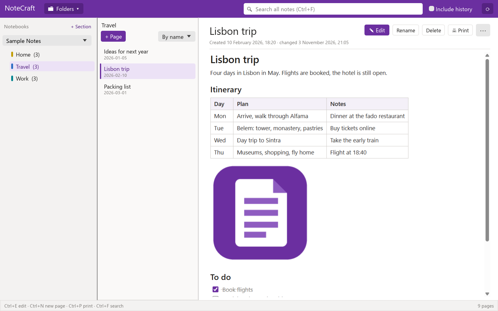
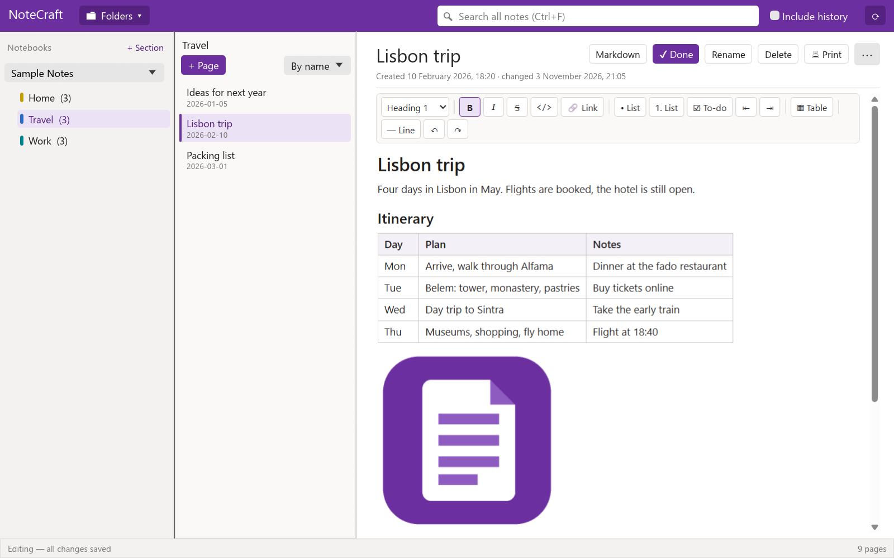
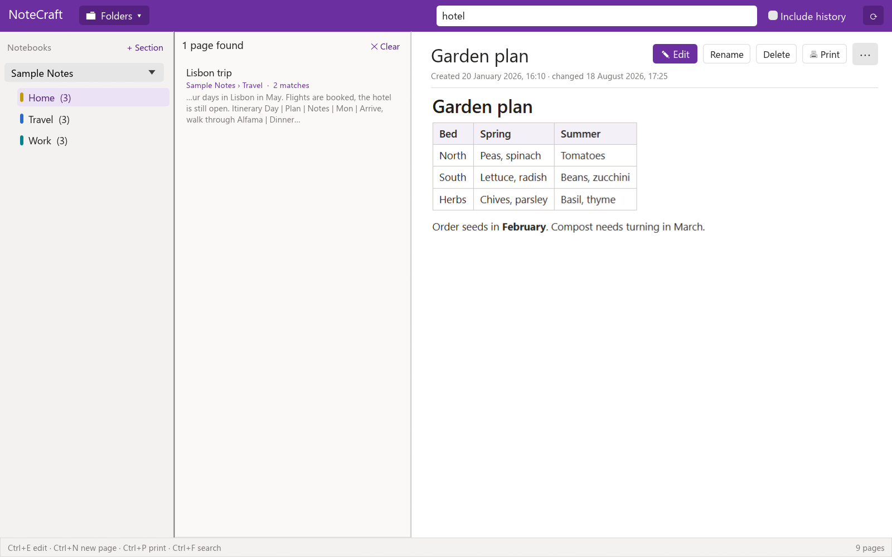
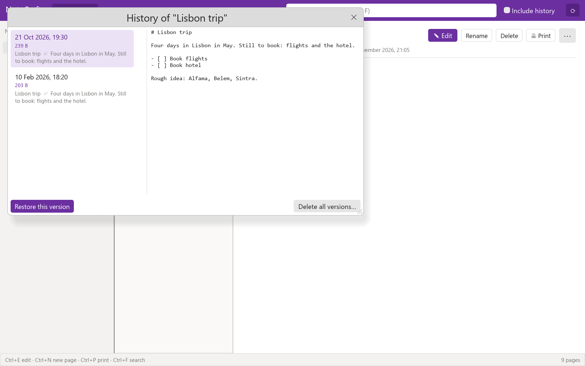
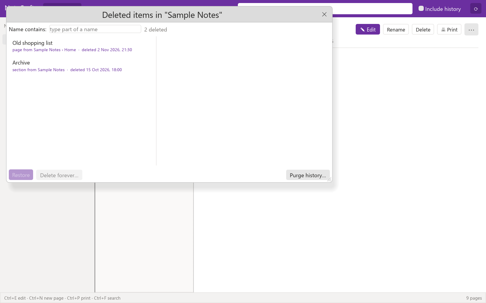
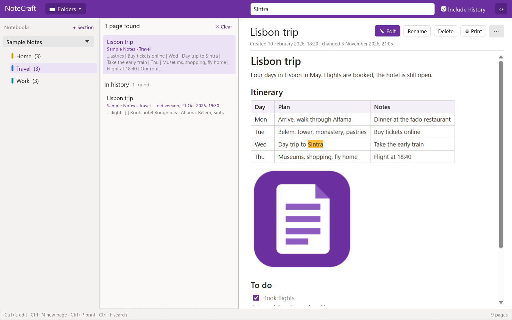

# NoteCraft

A desktop notebook for Windows that keeps every page as a plain Markdown file in a folder you
choose. There is no database and no cloud: the folders are the notebook, so you can keep them on a
network drive, back them up, search them with other tools and read them in any text editor.

NoteCraft is written in Rust (egui/eframe). Pages are shown and edited in a WebView2 view, so
Windows 10/11 with the WebView2 runtime is required.



## What it does

- **Notebooks as folders.** Open one or more folders. Each folder is a top-level notebook, its
  subfolders are sections, and the `.md` files in them are pages.
- **Subpages.** A folder named like a page (`Plan.md` and `Plan\`) holds that page's subpages.
- **Reading and editing in the same view.** Pages are shown formatted (headings, lists, tables,
  pictures, links, to-do checkboxes). Press Edit to change a page in place with a toolbar for
  styles, bold/italic/strikethrough/code, links, bulleted/numbered lists, to-dos, tables and
  dividing lines.
- **Pictures.** Paste or drop a picture into a page; it is saved in a `resources` folder next to
  the page.
- **Search.** One search box covers all open folders. Results show the notebook and section, the
  number of matches and a snippet.
- **Printing.** Print a page, or all pages of a section (the print window also offers "Save as PDF").
- **Shared folders.** While you edit a page, a small lock file next to it tells other computers
  not to edit, rename or delete it. A lock that is not refreshed for three minutes (crashed app,
  switched-off computer) is taken over.
- **History.** Old versions of pages and deleted pages are kept so you can recover from mistakes
  days or weeks later. See [History](#history).

## Screenshots

All screenshots show a made-up sample notebook.

| Editing a page | Search |
|----------------|--------|
|  |  |

| Versions of a page | Deleted items |
|--------------------|---------------|
|  |  |



## Page format

A page is a Markdown file with a small front matter block:

```markdown
---
title: Meeting notes
created: 2026-11-04T10:15:00
updated: 2026-11-04T11:02:00
---
# Meeting notes

Some **bold** text, a [link](https://example.com) and a to-do:

- [ ] call the printer
```

## Using it

Start `NoteCraft.exe`, choose **Folders ▸ Add folder…** and pick a folder. The left column shows
the sections of the selected folder, the middle column the pages of the selected section, and the
right side the page.

| Key      | Action                         |
|----------|--------------------------------|
| Ctrl+F   | Search all notes               |
| Ctrl+N   | New page in this section       |
| Ctrl+E   | Edit the page                  |
| Ctrl+S   | Save                           |
| Ctrl+P   | Print                          |
| Esc      | Leave editing (saves first)    |
| F5       | Reload notes from disk         |

Right-click a section or a page for more actions (rename, new subpage, print, show in File Explorer,
delete). The **⋯** menu next to a page has the same actions plus **History…**.

Folders can also be given on the command line: `NoteCraft.exe "U:\Notes" "D:\More notes"`.
Removing a folder from the view (**Folders ▸ Remove … from view**) never touches its files.

## History

NoteCraft keeps a `.history` folder inside each folder that has changes:

- `.history\pages\<page>\<date-time>.md` are earlier versions of a page. A version is saved when
  you save a page whose text changed and either the newest version is at least 10 minutes old or
  you removed a lot of text (more than 200 characters or 20 %).
- `.history\deleted\<date-time>\` holds pages and sections you deleted, with their subpages and
  versions. Nothing goes to the Windows Recycle Bin.

History is kept until you purge it. To use it:

- **History…** (page menu) lists the versions of the page with a preview. **Restore this version**
  keeps the current text as a version first, so a restore can be undone. It is disabled while the
  page has unsaved edits or is locked by someone else.
- **Folders ▸ Deleted items…** lists deleted pages and sections; restore one or delete it for good.
  A name that is taken again gets a number.
- **Folders ▸ Purge history…** removes all old versions and deleted items for good.
- **Include history** next to the search box also looks in old versions and deleted pages. It is
  off by default because it reads more files and can be slower, especially on a network drive. The
  hits show under "In history" and open in a read-only view with a Restore button.

If a version cannot be written (for example the drive is full) the save still succeeds and the
status bar says that the history copy failed.

The `.history` folders are ordinary files. If your notes are on a drive that is only occasionally
backed up, include them in the backup too.

## Building

Install the [Rust toolchain](https://rustup.rs/) (edition 2024, so a recent stable release), then:

```
cargo test                  :: unit tests
cargo build --release       :: target\release\notecraft.exe
make-dist.cmd               :: release build copied to dist\NoteCraft.exe
```

`NoteCraft.exe` is a single file that can be copied to other computers.

Command-line options meant for development and screenshots: `--page <file>`, `--edit`,
`--search <text>`, `--history`, `--show-history`, `--show-deleted`, `--screenshot <png>`
(use the release build for screenshots).

## Importing from OneNote

`tools\onenote-import` has a standalone Python 3 converter that turns OneNote `.one` files into
NoteCraft folders. See its [README](tools/onenote-import/README.md).

## Layout of the source

| Path                 | Contents                                                     |
|----------------------|--------------------------------------------------------------|
| `src\app.rs`         | The window: columns, menus, search, dialogs                  |
| `src\app\history_ui.rs` | History, deleted items and history-search windows          |
| `src\store.rs`       | Reading and writing folders and pages, the search index      |
| `src\history.rs`     | Versions, deleted items, purge and history search            |
| `src\lock.rs`        | Edit locks for shared folders                                |
| `src\render.rs`      | Markdown to HTML for viewing, searching and printing         |
| `src\web.rs`         | The WebView2 page view                                       |
| `assets\editor.*`    | The page view's HTML, CSS and JavaScript                     |
| `docs\superpowers`   | Design notes and implementation plans                        |
