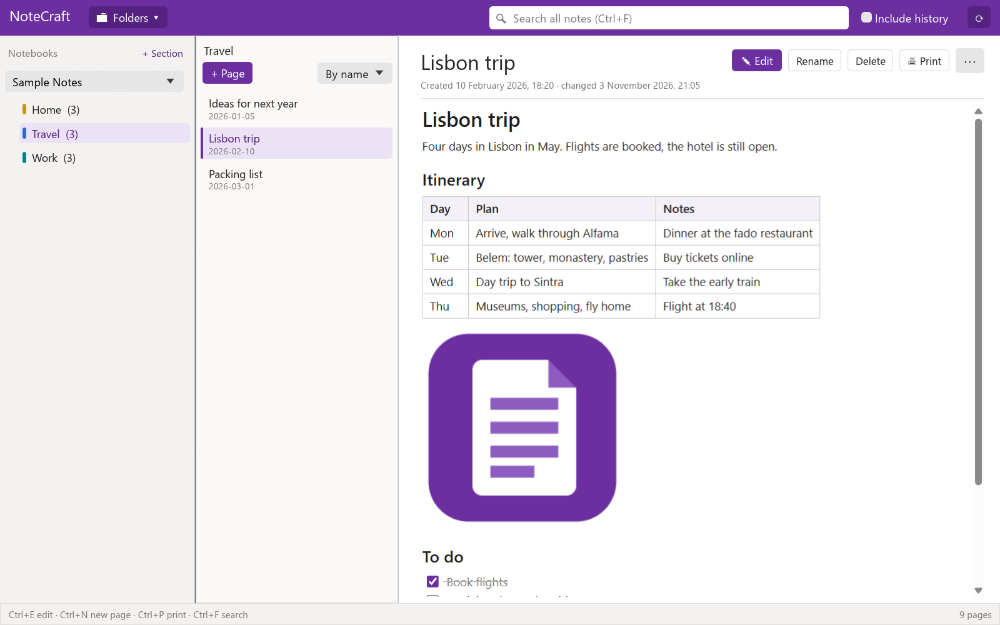
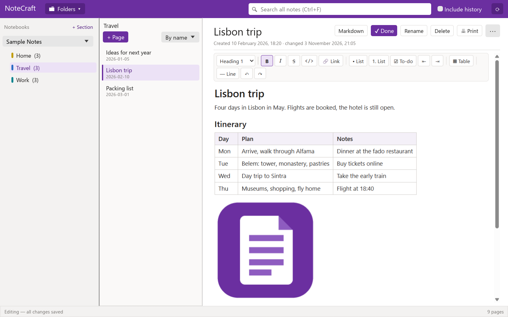
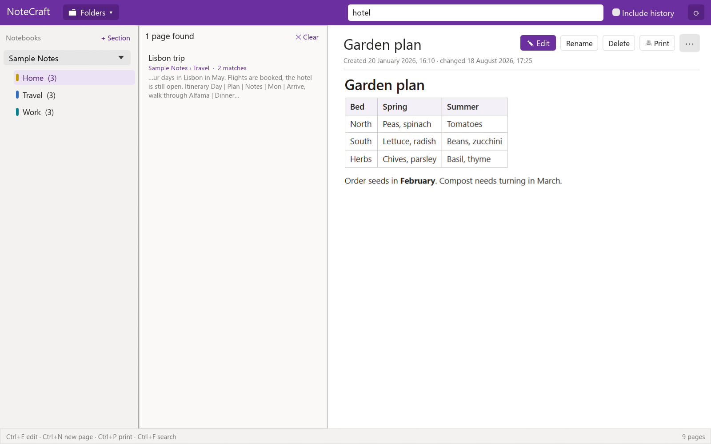
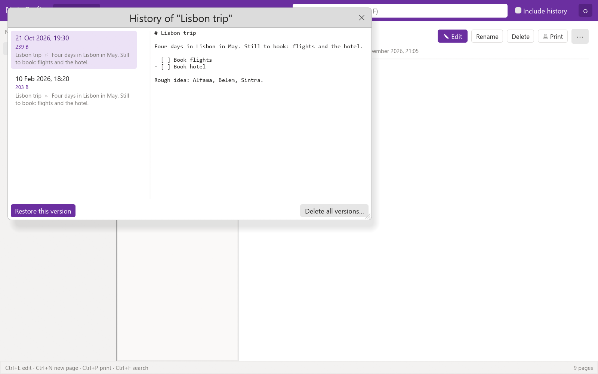
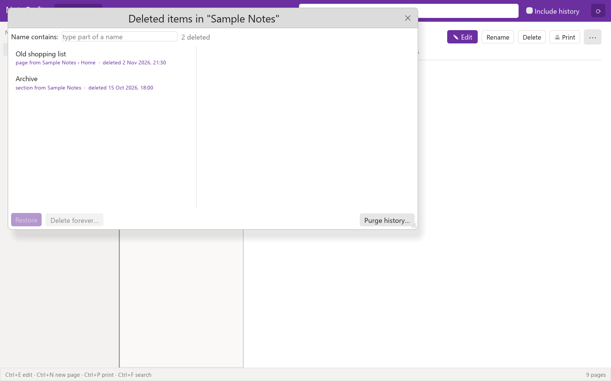
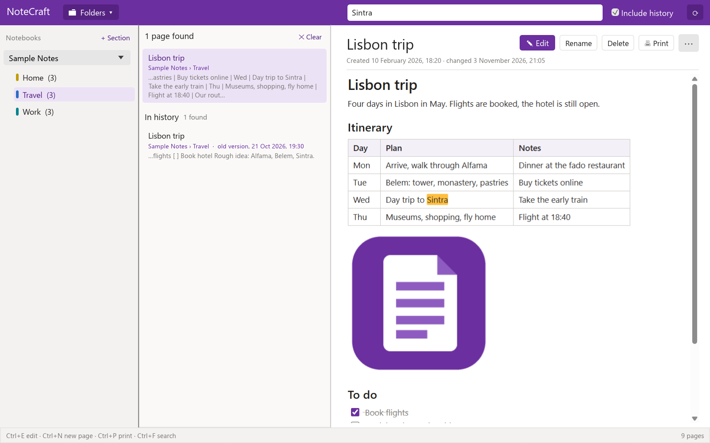

# NoteCraft

A desktop notebook for Windows that keeps every page as a plain Markdown file in a folder you
choose. There is no database and no cloud: the folders are the notebook, so you can keep them on a
network drive, back them up, search them with other tools and read them in any text editor.

NoteCraft is written in Rust (egui/eframe). Pages are shown and edited in a WebView2 view, so
Windows 10/11 with the WebView2 runtime is required.



## What it does

- **Notebooks as folders.** Open one or more folders. Each folder is a top-level notebook, its
  subfolders are sections, and the `.md` files in them are pages.
- **Subpages.** A folder named like a page (`Plan.md` and `Plan\`) holds that page's subpages.
- **Reading and editing in the same view.** Pages are shown formatted (headings, lists, tables,
  pictures, links, to-do checkboxes). Press Edit to change a page in place with a toolbar for
  styles, bold/italic/strikethrough/code, links, bulleted/numbered lists, to-dos, tables and
  dividing lines.
- **Pictures.** Paste or drop a picture into a page; it is saved in a `resources` folder next to
  the page.
- **Search.** One search box covers all open folders. Results show the notebook and section, the
  number of matches and a snippet.
- **Printing.** Print a page, or all pages of a section (the print window also offers "Save as PDF").
- **Shared folders.** While you edit a page, a small lock file next to it tells other computers
  not to edit, rename or delete it. A lock that is not refreshed for three minutes (crashed app,
  switched-off computer) is taken over.
- **History.** Old versions of pages and deleted pages are kept so you can recover from mistakes
  days or weeks later. See [History](#history).

## Screenshots

All screenshots show a made-up sample notebook.

| Editing a page | Search |
|----------------|--------|
|  |  |

| Versions of a page | Deleted items |
|--------------------|---------------|
|  |  |



## Page format

A page is a Markdown file with a small front matter block:

```markdown
---
title: Meeting notes
created: 2026-11-04T10:15:00
updated: 2026-11-04T11:02:00
---
# Meeting notes

Some **bold** text, a [link](https://example.com) and a to-do:

- [ ] call the printer
```

## Using it

Start `NoteCraft.exe`, choose **Folders ▸ Add folder…** and pick a folder. The left column shows
the sections of the selected folder, the middle column the pages of the selected section, and the
right side the page.

| Key      | Action                         |
|----------|--------------------------------|
| Ctrl+F   | Search all notes               |
| Ctrl+N   | New page in this section       |
| Ctrl+E   | Edit the page                  |
| Ctrl+S   | Save                           |
| Ctrl+P   | Print                          |
| Esc      | Leave editing (saves first)    |
| F5       | Reload notes from disk         |

Right-click a section or a page for more actions (rename, new subpage, print, show in File Explorer,
delete). The **⋯** menu next to a page has the same actions plus **History…**.

To move a page, drag it from the page list onto a section in the tree (it goes to the top of that
section) or onto another page in the list (it becomes a subpage of that page). **Move to…** in the
page's right-click or **⋯** menu does the same with a tree of all open folders. A page moves with
its subpages, its saved versions and its pictures; a picture stays in the old section as long as
another page there (or one of its versions, or a deleted page) still uses it.

To move a section, drag it in the tree onto another section (it becomes a section inside that one),
or use **Move to…** in the section's right-click menu. While a page or a section is dragged, the
other open notebooks are listed below the tree as drop rows, so it can also go into another
notebook. A section moves with everything inside it: its pages, subsections, pictures and saved
versions. If the target already has a section of that name, the moved one is named `Name (2)`.
A section cannot be moved into itself or one of its own subsections.

A move to another drive copies first and removes the originals afterwards. When a file there cannot
be removed (it is open in another program), the move still counts as done and NoteCraft lists the
files that stayed behind, so you can delete them later. When a later step of a page move fails, the
parts already moved are moved back; anything that could not be moved back stays at the new place,
and the error message says where.

Folders can also be given on the command line: `NoteCraft.exe "U:\Notes" "D:\More notes"`.
Removing a folder from the view (**Folders ▸ Remove … from view**) never touches its files.

## History

NoteCraft keeps a `.history` folder inside each folder that has changes:

- `.history\pages\<page>\<date-time>.md` are earlier versions of a page. A version is saved when
  you save a page whose text changed and either the newest version is at least 10 minutes old or
  you removed a lot of text (more than 200 characters or 20 %).
- `.history\deleted\<date-time>\` holds pages and sections you deleted, with their subpages and
  versions. Nothing goes to the Windows Recycle Bin.

History is kept until you purge it. To use it:

- **History…** (page menu) lists the versions of the page with a preview. **Restore this version**
  keeps the current text as a version first, so a restore can be undone. It is disabled while the
  page has unsaved edits or is locked by someone else.
- **Folders ▸ Deleted items…** lists deleted pages and sections; restore one or delete it for good.
  A name that is taken again gets a number.
- **Folders ▸ Purge history…** removes all old versions and deleted items for good.
- **Include history** next to the search box also looks in old versions and deleted pages. It is
  off by default because it reads more files and can be slower, especially on a network drive. The
  hits show under "In history" and open in a read-only view with a Restore button.

If a version cannot be written (for example the drive is full) the save still succeeds and the
status bar says that the history copy failed.

The `.history` folders are ordinary files. If your notes are on a drive that is only occasionally
backed up, include them in the backup too.

## Building

Install the [Rust toolchain](https://rustup.rs/) (edition 2024, so a recent stable release), then:

```
cargo test                  :: unit tests
cargo build --release       :: target\release\notecraft.exe
make-dist.cmd               :: release build copied to dist\NoteCraft.exe
```

`NoteCraft.exe` is a single file that can be copied to other computers.

Command-line options meant for development and screenshots: `--page <file>`, `--edit`,
`--search <text>`, `--history`, `--show-history`, `--show-deleted`, `--screenshot <png>`
(use the release build for screenshots), and `--import-onenote <notebook folder> <target folder>`
(see [Importing from OneNote](#importing-from-onenote)).

## Importing from OneNote

NoteCraft converts the `.one` files of a OneNote notebook into pages. You need the notebook as a
folder of `.one` files; they are only read, never changed.

Choose **Folders ▸ Import from OneNote…**. The window has three steps:

1. **OneNote notebook.** Type or browse to the folder with the notebook's `.one` files (a full path). The window
   shows how many sections it found, for example "Found 14 sections in 3 folders." Next is enabled
   when there is at least one section. The `OneNote_RecycleBin` folder is skipped.
2. **Target folder.** Type or browse to the folder to write into. The notebook is written to a
   subfolder named like the source folder, and the window shows that path. The target must be a full
   path (relative paths are refused) and must not be the source folder or inside it, and the source must not be inside the notebook's folder. If the
   notebook's folder already holds anything, NoteCraft asks once before it goes on: pages that
   already exist will be replaced, and their current text is kept in their history.
3. **Import.** A progress bar shows the section being written. Cancel stops after the section being
   written; what was written stays. At the end a summary lists the sections, the new, replaced and
   unchanged pages, the number of pictures and attachments written and any problems.

When the import is done the notebook folder (`<target>\<notebook>`) is added to the folders (or, if
it cannot be added, the view is reloaded) and the imported notebook is selected.

Every OneNote section becomes a folder of pages, and the folders of the source become folders around
them. A section or folder whose name is already taken gets `-1`, `-2` ... added to its name. A name
that starts with a dot gets `_` in front (`.NET` becomes `_.NET`), and a name NoteCraft hides
(`resources`, `_resources`, `attachments`) gets the number, so that the folder is shown. Pages with
the same title are numbered the same way, and a page called `resources` too; a page that starts
with a dot keeps its name.
Pictures and attachments are saved in a `resources` folder inside each section's folder.

Importing the same notebook again is safe:

- A page whose text did not change is not rewritten.
- A page that changed is replaced, and its old text is first saved as a version (see
  [History](#history)), whatever the age of the newest version.
- A page that someone is editing on another computer, or whose old text cannot be saved to the
  history, is skipped and listed under the problems.
- Pages that no longer exist in OneNote are not deleted from the target.

The same import can be run without a window:

```
NoteCraft.exe --import-onenote "E:\OneNote\Work" "D:\Notes"
```

It prints a line per section and then the summary. The exit code is 0 when every section was
imported, 1 when a section failed or the target was refused, and 2 when a folder is missing from
the command line.

The import is a port of the Python converter in `tools\onenote-import`, which is kept as the
reference implementation. The output is the same page for page, with these deliberate differences:

- Times are converted to the computer's own time zone (Python uses a fixed Central European rule).
- A page without a title is called `Untitled page` in the file name and in its title (Python writes
  the title `Neimenovana stran`).
- Leftover `<span>` tags are removed from every page.
- Pictures and attachments go to a `resources` folder next to each section's pages, as for pasted
  pictures (Python writes one `resources` folder for the whole notebook).
- Underline, superscript and subscript are kept, as `<u>`, `<sup>` and `<sub>` (Python drops them).

To compare the two importers, run both into empty scratch folders and run `compare.py` on the
notebook folders; see the [tool's README](tools/onenote-import/README.md).

## Layout of the source

| Path                 | Contents                                                     |
|----------------------|--------------------------------------------------------------|
| `src\app.rs`         | The window: columns, menus, search, dialogs                  |
| `src\app\history_ui.rs` | History, deleted items and history-search windows          |
| `src\app\import_ui.rs` | The Import from OneNote window                             |
| `src\store.rs`       | Reading and writing folders and pages, the search index      |
| `src\history.rs`     | Versions, deleted items, purge and history search            |
| `src\lock.rs`        | Edit locks for shared folders                                |
| `src\onenote\`       | OneNote import: `.one` parser, conversion, writing pages     |
| `src\render.rs`      | Markdown to HTML for viewing, searching and printing         |
| `src\web.rs`         | The WebView2 page view                                       |
| `assets\editor.*`    | The page view's HTML, CSS and JavaScript                     |
| `docs\superpowers`   | Design notes and implementation plans                        |

## License

MIT, see [LICENSE](LICENSE).
